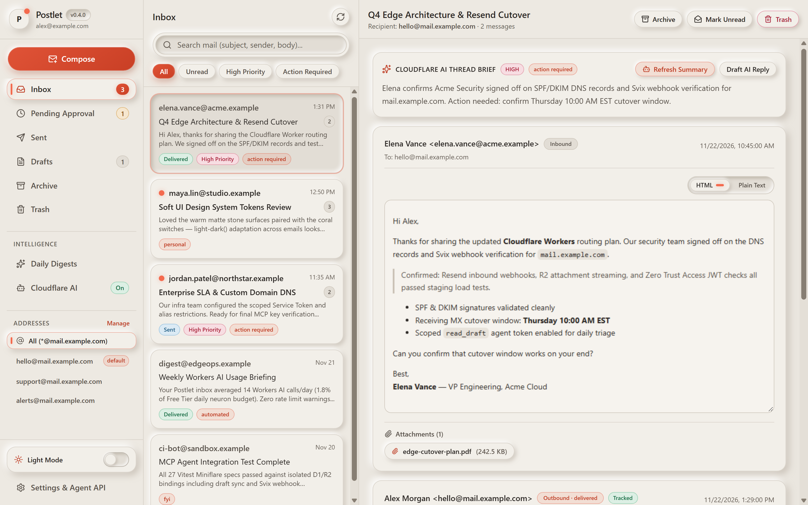
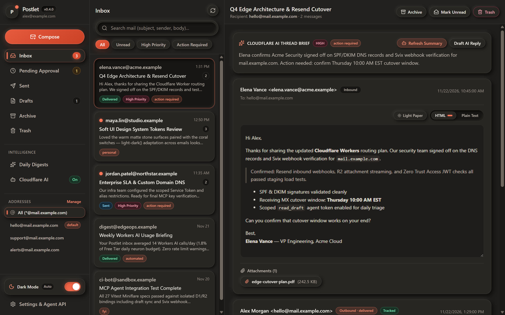
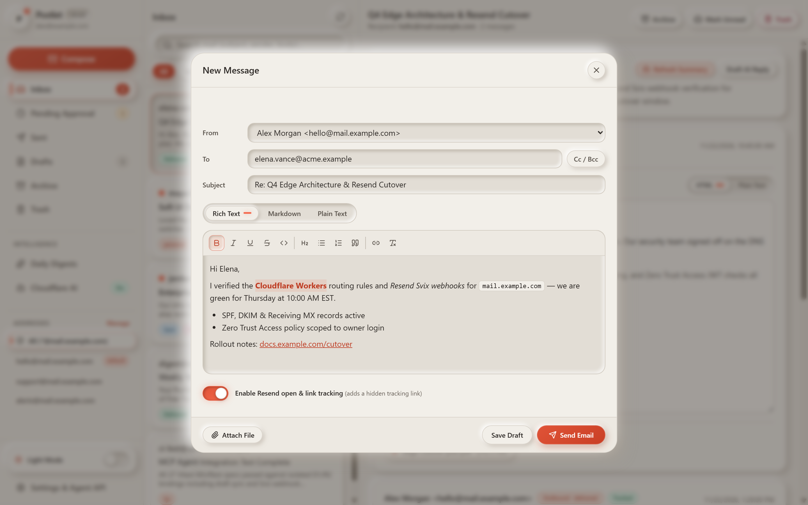
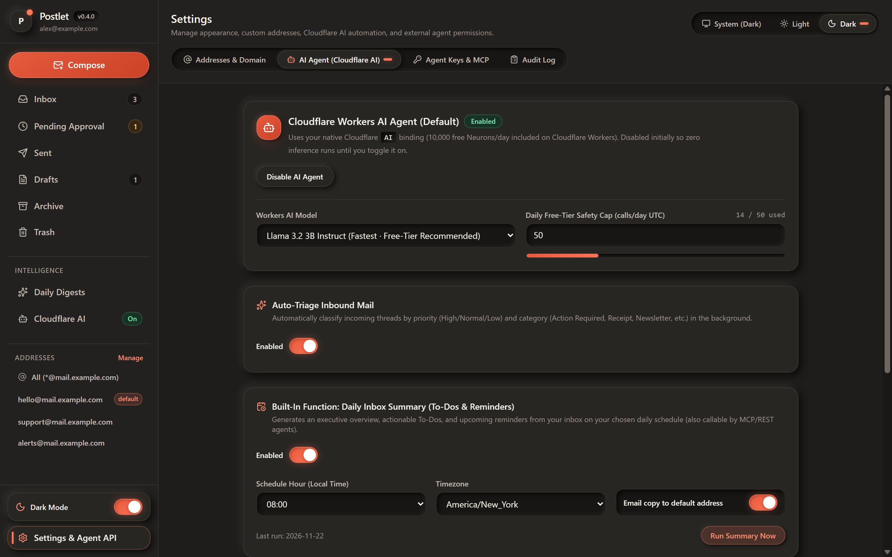

# Postlet 

Self-hosted, modular multi-domain email client and AI-agent mail gateway running on **Cloudflare Workers** — pairing **free unlimited inbound** via Cloudflare Email Routing with pluggable outbound transports (**Resend**, **Cloudflare Email Sending**, or **Amazon SES v2**), designed to deploy directly from GitHub and run comfortably inside Cloudflare's Free Tier for personal mailbots or scale cleanly on Paid plans for transactional workloads.

## Screenshots

### 3-Pane Mailbox — Light & Dark Modes





### Rich Text Composer & Cloudflare AI Settings

<table>
  <tr>
    <td width="50%">
      
      <p align="center"><em>Rich Text, Markdown &amp; Plain Text Composer with Engagement Tracking Toggle</em></p>
    </td>
    <td width="50%">
      
      <p align="center"><em>Settings &amp; Built-In Cloudflare Workers AI Controls (Dark Mode)</em></p>
    </td>
  </tr>
</table>

## Features

- **Full-Featured Web Inbox** (`/`): Tactile Soft UI responsive 3-pane interface with automatic OS color-scheme detection + persistent Light / Dark / System theme toggle, folder navigation, search (SQLite FTS5), sandboxed sanitized HTML email viewing, plain-text fallback, R2 attachment uploads/downloads, Rich Text (Bold, Italic, Underline, Strikethrough, Code, Headings, Lists, Blockquotes, Links), Markdown, and Plain Text composer, saved draft editing/discarding, Reply / Reply All / Forward, optional open & link tracking switch, and live delivery + engagement status tracking (`sent`, `delivered`, `delayed`, `bounced`, `complained`, `email.opened`, `email.clicked`).
- **Free Unlimited Multi-Domain Inbound (Cloudflare Email Routing + `postal-mime`)**: Route catch-all mail across multiple custom domains directly into the Worker `email()` handler—parsing RFC 5322 MIME streams and streaming R2 attachments at zero Resend inbound quota cost—while preserving `/api/webhooks/resend` inbound webhook support.
- **Unified & Per-Domain Scoped Inboxes**: View every configured domain together in **All Mailboxes** with domain badges, or click any domain/alias in the **Mailboxes** sidebar (with live per-domain unread counters) to scope the message list and default composer sender instantly.
- **Pluggable Outbound Transports (`MAIL_PROVIDER`)**:
  - **`resend`** *(Default)*: Ideal for free personal mailboxes (using Resend outbound while receiving unlimited mail free through Cloudflare Email Routing).
  - **`cloudflare`**: Native Cloudflare Email Service (`send_email` binding + Queue consumer) for Workers Paid accounts sending transactional volume inside Cloudflare.
  - **`ses`**: Pure Web Crypto AWS SigV4 client for Amazon SES v2 (`v2/email/outbound-emails`) + cryptographically verified X.509 SNS webhooks (`/api/webhooks/ses`).
- **Self-Hosted Open & Click Tracking (`/t/*`)**: Optional provider-agnostic HMAC-SHA256 signed pixel (`/t/o/:token.gif`) and link redirect (`/t/c/:token`) endpoints enabled via `TRACKING_BASE_URL` + `TRACKING_SECRET` (automatically falling back to Resend native tracking when unset).
- **Cloudflare Zero Trust Access Authentication**: Protects the Web UI and `/api/admin/*` with cryptographic RS256 JWKS verification of `Cf-Access-Jwt-Assertion` tokens.
- **Built-In Cloudflare Workers AI Agent (`postlet-ai`)** *(Disabled by default)*: Uses your native Cloudflare `AI` binding (10,000 free Neurons/day). Toggle on in **Settings → AI Agent** to unlock:
  - **Auto-Triage & Cached Thread Summaries**: Priority (`high`/`normal`/`low`) and category classification cached in D1.
  - **Daily Inbox Summary (To-Dos & Reminders)**: Scheduled via hourly Worker Cron trigger at your chosen hour/timezone (or run on-demand) with interactive To-Do checklists and optional email delivery.
  - **Important Email Auto-Reply**: Drafts (Pending Approval) or sends automatic replies to urgent human emails with strict multi-domain RFC 3834 loop protection (`Auto-Submitted`, `List-Unsubscribe`, `noreply@`, all owned domains/aliases blocked, and per-sender cooldown).
- **AI Agent Gateway (`/mcp` & `/api/v1/*`)**: Issue scoped API keys (`read_only`, `read_draft`, `read_write`) with optional alias locks, recipient domain allowlists, hourly rate limits, allowed built-in AI functions, one-click MCP/cURL snippets, and a unified Audit Log.

---

## Architecture & Free-Tier Optimization

- **Single Worker + Static Assets**: Built with Vite + `@cloudflare/vite-plugin` (`run_worker_first: ["/api/*", "/mcp", "/t/*"]` so UI assets serve directly at the edge).
- **Zero-Quota Personal Mode**: Receive unlimited emails across all your domains through Cloudflare Email Routing (`email()` handler + `postal-mime`) and keep Resend strictly for outbound personal emails (`MAIL_PROVIDER: "resend"`), keeping inbound mail off your Resend quota.
- **Cloudflare D1**: Stores threads, messages, FTS5 search index, hashed API keys, settings, AI digests, and audit logs using targeted composite indexes to minimize row reads.
- **Cloudflare R2**: Streams attachment uploads/downloads directly and serves downloads with `Cache-Control: private, max-age=31536000, immutable` to minimize Class B reads.
- **Cloudflare Workers AI**: Caches summaries/triage in D1 and enforces a configurable daily call cap (`50/day` default) to stay safely inside the 10,000 free Neurons/day allowance.

---

## Local Development

```bash
# 1. Install dependencies
npm install

# 2. Copy local environment templates
cp .env.example .env
cp .dev.vars.example .dev.vars

# 3. Apply D1 migrations locally
npm run db:migrate:local

# 4. Start Vite dev server (runs frontend + Worker with local Miniflare D1/R2)
npm run dev
```

Run checks and tests:

```bash
npm run typecheck
npm test
npm run build
```

---

## Deployment via GitHub → Cloudflare Workers Git Sync

### 1. Automatic D1 & R2 Provisioning (Zero Manual DB Setup)
`wrangler.jsonc` uses **Wrangler Automatic Resource Provisioning** (no `database_id` hardcoded in Git) and stays 100% **Workers Free Tier** compatible out of the box (`MAIL_PROVIDER: "resend"`, no Paid-only bindings enabled by default):
- On first deployment, Cloudflare automatically creates the `postlet-db` D1 database and `postlet-attachments` R2 bucket and binds them to `DB` and `ATTACHMENTS` (and reuses them automatically on all future deploys).
- On first Worker execution (HTTP request, inbound email, or scheduled Cron), Postlet's runtime schema bootstrapper automatically creates any missing D1 tables, FTS5 search indexes, triggers, and safe default settings (`ai_enabled = 'false'`).

#### Two One-Time Cloudflare Dashboard Prerequisites
Before your first Git-triggered deploy:
1. **Enable R2 Object Storage**: Open **Cloudflare Dashboard → R2 Object Storage** and activate R2 once on your account (10 GB/month Free Tier).
2. **Grant `D1: Edit` to Workers Builds**: In **Cloudflare Dashboard → My Profile → API Tokens**, edit the Workers Builds API token and add **Account → D1 → Edit** (Cloudflare's default auto-generated build token omits `D1: Edit`, which is needed to auto-create `postlet-db` and apply migrations).

### 2. Connect GitHub Repo in Cloudflare Dashboard
1. Open **Cloudflare Dashboard → Workers & Pages → Create → Import a repository**.
2. Select your Postlet GitHub repository.
3. Set:
   - **Build command**: `npm run build`
   - **Deploy command**:
     - Zero-config option (schema self-bootstraps at runtime): `npx wrangler deploy`
     - Or with formal `d1_migrations` tracking: `npm run deploy:ci` (runs `wrangler deploy` to provision `postlet-db` first, then applies `migrations/` remotely)
4. Attach your custom domain under **Worker → Settings → Domains & Routes → Add → Custom Domain** (e.g., `mail.yourdomain.com`).
5. After first deploy, verify your Worker bindings under **Settings → Bindings**:
   - `DB` → D1 database `postlet-db`
   - `ATTACHMENTS` → R2 bucket `postlet-attachments`
   - `AI` → Workers AI

### 3. Configure Environment Variables & Secrets on Cloudflare Dashboard
Open **Worker → Settings → Variables and Secrets** and add the variables for your setup.

**Should they be `Text` or `Secret`?**
To your running Worker code (`env.VARIABLE`), **`Text` and `Secret` behave identically**. The difference is purely about security and convenience in the Cloudflare Dashboard:
- **Always use `Secret`** for actual credentials (`RESEND_API_KEY`, `RESEND_WEBHOOK_SECRET`, `AWS_SES_SECRET_ACCESS_KEY`, `SES_WEBHOOK_SECRET`, `TRACKING_SECRET`). Secrets are encrypted at rest and hidden permanently after saving.
- **`Text` or `Secret` both work** for non-secret config values (`CF_ACCESS_TEAM_DOMAIN`, `CF_ACCESS_AUD`, `MAIL_DOMAIN`, `MAIL_PROVIDER`, `AWS_SES_REGION`, `TRACKING_BASE_URL`). Choosing `Text` lets you view and double-check them later in the Dashboard; choosing `Secret` masks them if you prefer not to leave config values readable in Dashboard screens.
- **Safe across GitHub deploys**: `wrangler.jsonc` sets `"keep_vars": true`, so Dashboard `Text` variables are preserved across future GitHub pushes.
- **Managed automatically**: `APP_NAME`, `APP_VERSION`, and `DEFAULT_AI_MODEL` (plus default `"MAIL_PROVIDER": "resend"`) are set in `wrangler.jsonc` — override `MAIL_PROVIDER` in Dashboard Secrets/Vars or per deployment only if switching providers.
- **Production safety**: Do **not** set `DEV_BYPASS_ACCESS` in production.

#### Core Variables (All Setups)

| Name | Recommended Type | Example / Where to Find It | Purpose |
|---|---|---|---|
| `CF_ACCESS_TEAM_DOMAIN` | **Text** or **Secret** *(Required)* | `myteam.cloudflareaccess.com` (Zero Trust → Settings) | Your Zero Trust team domain (`https://` optional; normalized automatically). |
| `CF_ACCESS_AUD` | **Text** or **Secret** *(Required)* | 64-char hex AUD tag on your main Access App | Application Audience (AUD) tag used to verify the Access JWT signature and audience. |
| `MAIL_DOMAIN` | **Text** or **Secret** *(Recommended)* | `domain1.com,domain2.dev` | Comma-separated mail domains accepted as fallback before editing in **Settings → Addresses & Domain**. |
| `MAIL_PROVIDER` | **Text** *(Optional)* | `resend` *(default)* \| `cloudflare` \| `ses` | Selects the active outbound transport provider. Defaults cleanly to `resend`. |

#### Provider A: Personal Free Tier (`MAIL_PROVIDER=resend` + Cloudflare Email Routing Inbound)

| Name | Recommended Type | Example / Where to Find It | Purpose |
|---|---|---|---|
| `RESEND_API_KEY` | **Secret** *(Required)* | `re_...` from Resend Dashboard → API Keys | Outbound **Sending** (plus Receiving if you also use `/api/webhooks/resend`). |
| `RESEND_WEBHOOK_SECRET` | **Secret** *(Required for Resend webhooks)* | `whsec_...` from Resend Dashboard → Webhooks | Verifies delivery status (`sent`, `delivered`, `bounced`) and optional Resend inbound webhooks via Svix HMAC-SHA256. |

#### Provider B: High-Volume / Transactional via Native Cloudflare (`MAIL_PROVIDER=cloudflare`, Workers Paid)
For projects on a paid Workers account sending 300–500+ emails/day directly inside Cloudflare without third-party SMTP credentials:
1. Set `MAIL_PROVIDER` = `cloudflare`.
2. Enable Email Service outbound bindings on that project's `wrangler.jsonc`:
```jsonc
"send_email": [
  { "name": "EMAIL" }
],
"queues": {
  "consumers": [
    { "queue": "postlet-email-events", "max_batch_size": 25 }
  ]
}
```
3. Attach the queue notification topic from Cloudflare Email Service to `postlet-email-events` so `queue()` automatically updates `delivered` / `bounced` / `delayed` / `complained` statuses in D1.

#### Provider C: High-Volume / Transactional via Amazon SES v2 (`MAIL_PROVIDER=ses`)

| Name | Recommended Type | Purpose |
|---|---|---|
| `MAIL_PROVIDER` | **Text** | Set to `ses`. |
| `AWS_SES_ACCESS_KEY_ID` | **Secret** | IAM access key with `ses:SendEmail` / `ses:SendRawEmail`. |
| `AWS_SES_SECRET_ACCESS_KEY` | **Secret** | IAM secret key used for pure Web Crypto AWS SigV4 request signing. |
| `AWS_SES_REGION` | **Text** | AWS region (e.g., `us-east-1`). |
| `AWS_SES_CONFIGURATION_SET` | **Text** *(Optional)* | SES Configuration Set publishing Delivery/Bounce/Complaint/Open/Click events to SNS. |
| `SES_WEBHOOK_SECRET` | **Secret** *(Optional, Recommended)* | Shared secret appended as `?secret=...` or `x-postlet-webhook-secret` header on SNS HTTPS endpoints. |
| `SES_SNS_TOPIC_ARN` | **Text** *(Optional, Recommended)* | Exact SNS Topic ARN allowlist checked alongside X.509 PEM RSA signature verification. |

Point your Amazon SNS HTTPS subscription to `https://mail.yourdomain.com/api/webhooks/ses?secret=<SES_WEBHOOK_SECRET>` — Postlet automatically confirms `SubscriptionConfirmation` callbacks and processes `Notification` events.

#### Optional: Provider-Agnostic Self-Hosted Engagement Tracking (`/t/*`)
Works with **any** outbound provider (`resend`, `cloudflare`, or `ses`) when both variables below are set (when unset, `resend` continues using Resend's native tracking):

| Name | Recommended Type | Example | Purpose |
|---|---|---|---|
| `TRACKING_BASE_URL` | **Text** | `https://mail.yourdomain.com` | Public origin embedded in signed open pixel & click-redirect links. |
| `TRACKING_SECRET` | **Secret** | 32+ byte random string (`openssl rand -hex 32`) | HMAC-SHA256 key signing `/t/o/:token.gif` and `/t/c/:token` tokens against tampering. |

### 4. Configure Multi-Domain Inbound Routing (Free Unlimited via Cloudflare Email Routing)
1. For each domain you own on Cloudflare (**Dashboard → Domain → Email → Email Routing**):
   - Enable Email Routing (Cloudflare automatically adds free receiving MX & SPF records).
   - Under **Routing rules → Catch-all address**, edit action to **Send to a Worker** and choose your `postlet` Worker (and/or add individual custom addresses pointing to the same `postlet` Worker).
2. Add all routed domains in Postlet under **Settings → Addresses & Domain** (`Mail Domains`, e.g., `phnxlabs.dev, otherdomain.com`) or via comma-separated `MAIL_DOMAIN`.
3. Note: Even when inbound arrives free via Cloudflare Email Routing (`email()`), leave your DNS DKIM/SPF records configured for your chosen `MAIL_PROVIDER` (`resend`, `cloudflare`, or `ses`) so outbound mail passes DMARC cleanly! *(Using Cloudflare Email Routing MX records for inbound + Resend subdomain `send.yourdomain.com` SPF/DKIM for outbound avoids any MX conflict.)*

### 5. Configure Cloudflare Zero Trust Access

Cloudflare Access is an interactive browser login gate (redirecting unauthenticated requests to an OTP / SSO login page). Postlet uses **path-scoped Access applications** so human Web UI routes stay locked behind your email login while non-browser machine endpoints (`/api/webhooks/*`, `/t/*`, `/api/v1/*`, `/mcp`) can present their own cryptographic credentials directly.

> **Important:** Never add a `Bypass` policy to your root `mail.yourdomain.com` application — that would bypass Access for the entire Web UI. Always place Bypass or Service Auth policies on **separate Self-hosted applications scoped to specific sub-paths**. Cloudflare Access evaluates only the most specific matching path for a request, so `/` and `/api/admin/*` remain strictly protected.

#### 5a. Main Application (Protects Web UI `/` and `/api/admin/*`)
1. Go to **Cloudflare Zero Trust → Access controls → Applications → Add an application → Self-hosted**.
2. Set:
   - **Application domain**: `mail.yourdomain.com` (leave **Path** blank so it covers `/` and `/api/admin/*`).
3. Add an **Allow** policy:
   - **Action**: `Allow`
   - **Rule type**: `Include`
   - **Selector**: `Emails`
   - **Value**: your personal email address (e.g., `you@example.com`)
4. Save the application, then copy its **Application Audience (AUD) Tag** into `CF_ACCESS_AUD` (and confirm your team domain `<team>.cloudflareaccess.com` under **Zero Trust → Settings** for `CF_ACCESS_TEAM_DOMAIN`).

#### 5b. Non-Browser Machine & Tracking Endpoints (Sub-Path Applications)
Create separate **Self-hosted** applications only for the machine/tracking paths you actually use (`Action: Bypass` → `Include` → `Everyone`):

| Sub-Path Application Domain | Policy | Required? | Why Needed |
|---|---|---|---|
| `mail.yourdomain.com/api/webhooks/resend` | `Bypass` → Include → `Everyone` | **When using Resend** | Resend delivers outbound delivery status webhooks (and optional Resend inbound) here without a browser session. |
| `mail.yourdomain.com/api/webhooks/ses` | `Bypass` → Include → `Everyone` | **Only if using `MAIL_PROVIDER=ses`** | Amazon SNS posts X.509-signed delivery/bounce/open/click notifications here. |
| `mail.yourdomain.com/t/*` | `Bypass` → Include → `Everyone` | **Only if using self-hosted tracking** | Lets external email clients load signed `/t/o/:token.gif` open pixels and follow `/t/c/:token` click links without Access login prompts. |
| `mail.yourdomain.com/api/v1/*` | `Bypass` → `Everyone` *(or `Service Auth`)* | **Only if using REST API / scripts** | Lets external scripts/services call Postlet REST APIs; `/*` covers all sub-routes. |
| `mail.yourdomain.com/mcp` | `Bypass` → `Everyone` *(or `Service Auth`)* | **Only if using external MCP AI agents** | Lets Claude, Cursor, Antigravity, etc. connect via Streamable HTTP MCP. |
| `mail.yourdomain.com/api/health` | `Bypass` → Include → `Everyone` | **Optional** | Only needed if an external uptime monitor probes `/api/health` without Access auth. |

#### 5c. Why Bypass on These Paths Is Still Secure (Defense-in-Depth)
Setting a sub-path to **Bypass** disables Cloudflare's browser login redirect *only on that exact path* — the Worker still enforces strict application-layer authentication before exposing any mailbox data:

| Path | Cloudflare Access Gate | Worker-Side Cryptographic Security |
|---|---|---|
| `/` & `/api/admin/*` | **Allow (`Emails`)** — **Never bypassed** | Re-verifies the `Cf-Access-Jwt-Assertion` RS256 signature against Cloudflare's JWKS keys (`iss`, `aud`, `exp`) on every `/api/admin/*` call, plus CSRF header/Origin validation on mutations. |
| `/api/webhooks/resend` | **Bypass (`Everyone`)** | Verifies Svix **HMAC-SHA256** (`svix-id`, `svix-timestamp`, `svix-signature`) using `RESEND_WEBHOOK_SECRET` with constant-time comparison and a ±5-minute replay window. Unsigned or forged requests receive `401`. |
| `/api/webhooks/ses` | **Bypass (`Everyone`)** | Verifies `x-postlet-webhook-secret` (when set), `SES_SNS_TOPIC_ARN` allowlist (when set), `https://sns.<region>.amazonaws.com` cert host check, and X.509 PEM **RSA SHA-256** SNS signature before processing. |
| `/t/*` | **Bypass (`Everyone`)** | Verifies **HMAC-SHA256** token signature against `TRACKING_SECRET` with constant-time comparison and restricts redirect schemes strictly to `http:` / `https:`. |
| `/api/v1/*` & `/mcp` | **Bypass** *(or `Service Auth`)* | Requires a scoped **`Authorization: Bearer plt_...`** API key (stored as SHA-256 hash in D1) enforcing tier (`read_only` / `read_draft` / `read_write`), optional alias locks, recipient-domain allowlists, hourly rate limits, instant revocation, and full audit logging. |

*(Optional extra hardening: swap `Bypass` on `/api/v1/*` and `/mcp` for Cloudflare Access `Service Auth` service tokens, or layer a WAF Custom Rule requiring `POST` + `svix-signature` on `/api/webhooks/resend`.)*

### 6. Configure Resend Outbound Domain & Delivery Webhooks *(When `MAIL_PROVIDER=resend`)*
1. In **Resend Dashboard → Domains**, add and verify outbound DNS records (SPF on `send` subdomain + DKIM) for your domain(s). *(Tip: If Cloudflare Email Routing handles inbound mail on `@yourdomain.com`, you do **not** need Resend's root `@` receiving MX record.)*
2. In **Resend Dashboard → Webhooks**, add an endpoint pointing to `https://mail.yourdomain.com/api/webhooks/resend` and subscribe to `email.sent`, `email.delivered`, `email.delivery_delayed`, `email.bounced`, `email.complained` *(plus `email.received` if routing inbound via Resend, and `email.opened` / `email.clicked` if not using `/t/*`)*.
3. Copy the Signing Secret (`whsec_...`) into Cloudflare Worker Secret `RESEND_WEBHOOK_SECRET`.

### 7. First Login & Optional AI Activation
1. Visit `https://mail.yourdomain.com` and sign in via Cloudflare Zero Trust.
2. Open **Settings → Addresses & Domain** to configure your **Mail Domains** (`domain1.com, domain2.dev`) and add sender aliases (e.g., `me@domain1.com`, `hello@domain2.dev`).
3. *(Optional)* Open **Settings → AI Agent (Cloudflare AI)** to toggle on the built-in Cloudflare AI agent, Daily Inbox Summaries (To-Dos & Reminders), and Important Email Auto-Reply.
4. Open **Settings → Agent Keys & MCP** to generate `read_only`, `read_draft`, or `read_write` tokens with ready-to-copy MCP JSON and `curl` snippets.
